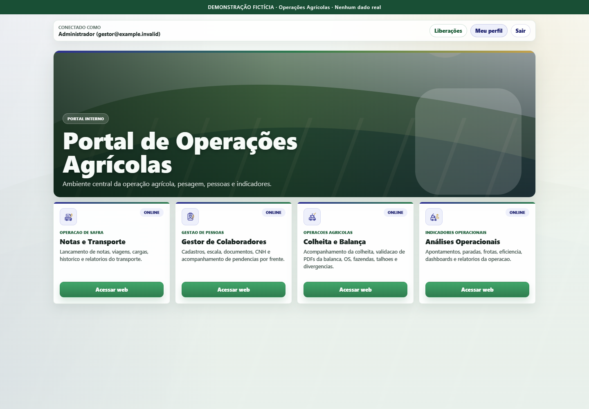
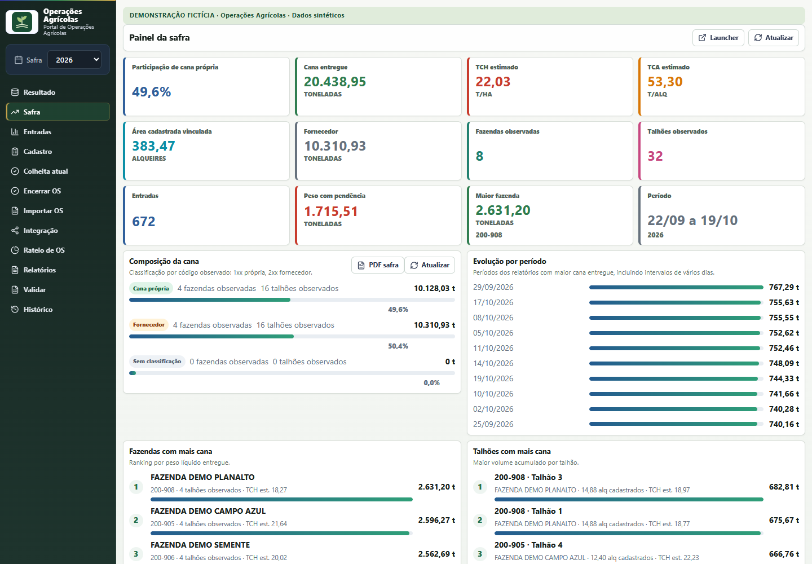
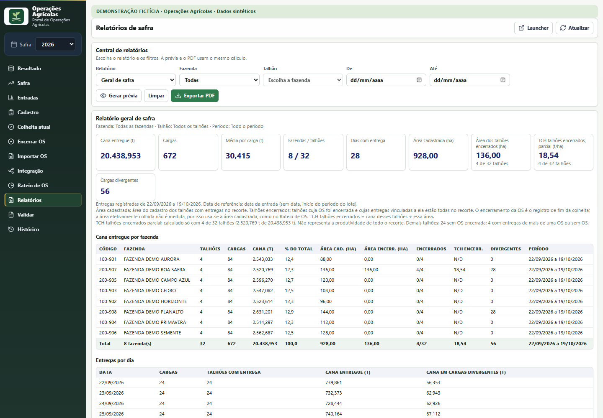
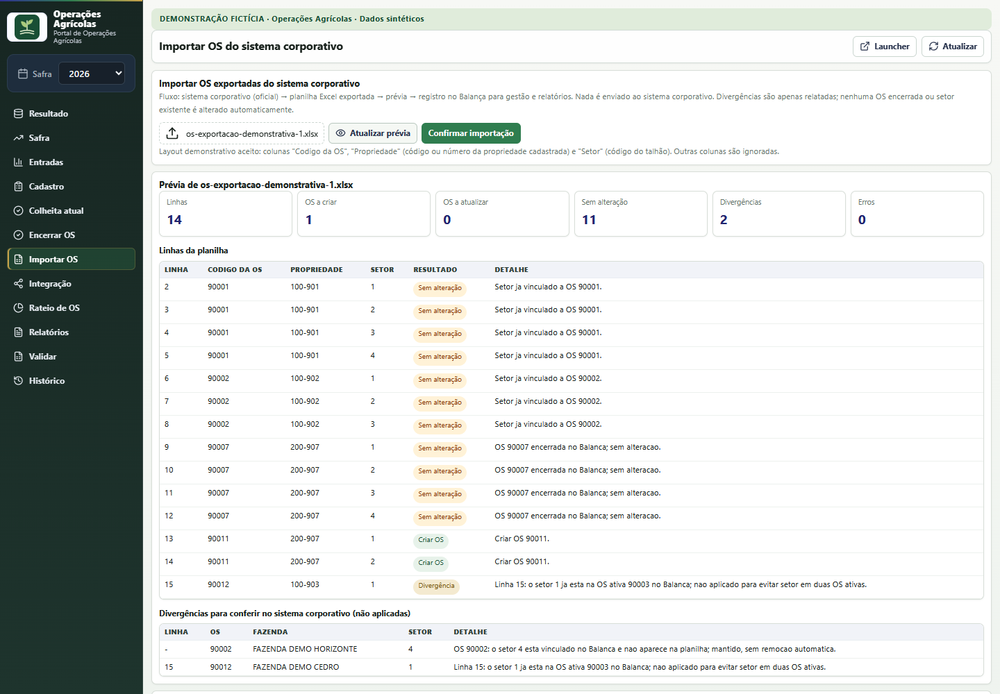
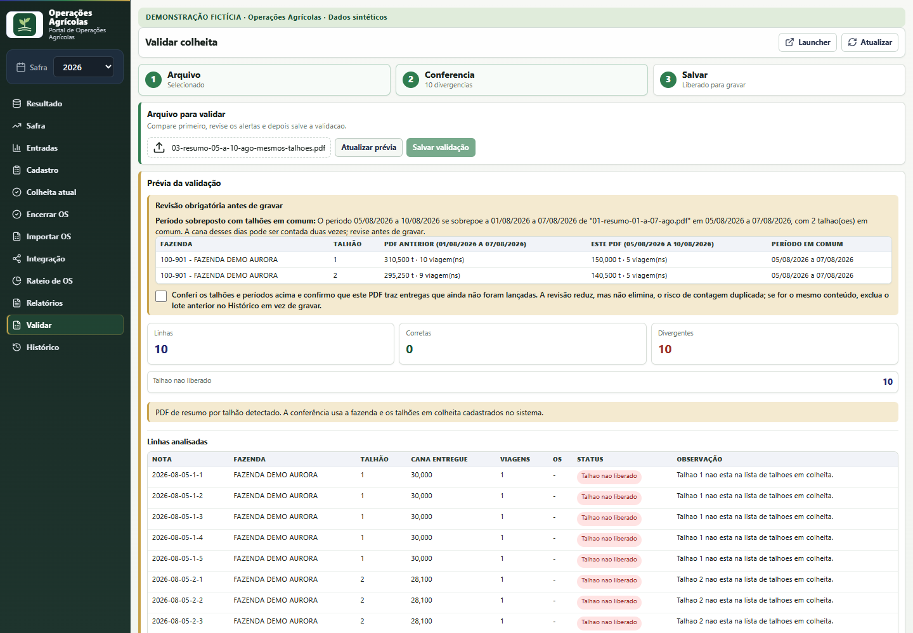

# Operações Agrícolas

[](https://github.com/gabrisantoss/operacoes-agricolas/actions/workflows/validate.yml)

Uma suíte integrada para acompanhar a rotina agrícola: colheita, pesagem, transporte, colaboradores e indicadores operacionais.

**Projeto de portfólio com demonstração funcional e dados inteiramente fictícios.** Os números, pessoas, propriedades, frotas e movimentações apresentados não representam uma operação real. Esta distribuição não contém módulo de mapas.



## O projeto em um minuto

O sistema conecta o trabalho administrativo ao acompanhamento da operação. Um único portal autentica o usuário e reúne quatro aplicações, mantendo suas regras, interfaces, bancos, relatórios e integrações.

| Módulo | O que é possível explorar |
| --- | --- |
| Colheita e Balança | Fazendas e talhões, ordens de serviço, liberações e encerramentos, importação de pesagens (CSV/XLSX/PDF), divergências, rateio, frota, fechamento de safra, central de relatórios, importação gerencial de OS via Excel e alertas de sobreposição de PDFs. |
| Notas e Transporte | Lançamentos, proteção do histórico, cadastros, integração com colaboradores e Balança, rankings e relatórios PDF/Excel. |
| Colaboradores | Cadastro e consulta, escala, acompanhamento de CNH, pendências documentais e relatórios. |
| Análises Operacionais | Apontamentos, paradas, motivos, eficiência por turno e frente, colheita e exportações. |
| Portal | Login compartilhado, permissões, auditoria, navegação e acompanhamento da disponibilidade dos módulos. |

Não é uma coleção de telas estáticas: os backends persistem as alterações em PostgreSQL, as APIs respondem aos filtros e as exportações são produzidas pelo código da aplicação.

## Cenário demonstrativo

Imagine uma organização fictícia acompanhando quatro frentes de trabalho durante uma safra. A equipe cadastra propriedades, libera talhões, confere pesagens, registra viagens e acompanha disponibilidade de pessoas e equipamentos.

O primeiro preparo gera:

- 8 fazendas, 32 talhões e 8 ordens de serviço;
- 672 registros de pesagem, incluindo divergências deliberadas para investigação;
- 32 colaboradores fictícios, com diferentes situações de CNH;
- 84 notas de transporte;
- 112 apontamentos de parada e 112 registros de colheita;
- uma base fictícia de frotas e um CSV de exemplo para importação;
- três planilhas demonstrativas de OS e sete PDFs sintéticos de resumo de cana para os cenários de importação.

As datas são relativas ao primeiro preparo. Os indicadores são calculados a partir desse cenário: não são resultados de negócio atribuídos a clientes.



## Destaques da Colheita e Balança

- **Importação de pesagens:** CSV com separador `;` ou `,` detectado automaticamente, mapeamento de colunas conferido na prévia e controle por hash contra reimportação.
- **Central de relatórios de safra:** relatório geral e detalhado por fazenda, talhão e período, com prévia e PDF gerados pelo mesmo cálculo. A tela distingue área cadastrada de área dos talhões com OS encerrada, e o TCH aparece como N/D ou "parcial" quando os dados não comprovam a área.
- **Importação gerencial de OS via Excel:** planilha exportada do sistema corporativo, com prévia, divergências não aplicadas (setor em outra OS ativa, OS encerrada, setor ausente), detecção de reimportação, histórico e relatório CSV. Nada é enviado de volta ao sistema corporativo ([detalhes](docs/IMPORTACAO_OS.md)).
- **Importação manual de PDFs:** arquivo idêntico bloqueado; períodos sobrepostos ou conteúdo repetido com os mesmos talhões exigem revisão explícita, e períodos coincidentes com outras fazendas são aceitos ([detalhes](docs/IMPORTACAO_PDF.md)).



| Importação de OS via Excel | Alerta de sobreposição de PDF |
| --- | --- |
|  |  |

## Executar localmente

Ambiente validado: **Windows, Python 3.12, Node.js 22, npm 11 e PostgreSQL 17**. Instale esses pré-requisitos antes de continuar. Não é necessário criar um serviço PostgreSQL para a demonstração: o controlador cria seu próprio cluster local.

```powershell
git clone https://github.com/gabrisantoss/operacoes-agricolas.git
cd operacoes-agricolas
py -3.12 demo.py setup
py -3.12 demo.py credentials
py -3.12 demo.py start --open
```

A leitura de PDFs usa o `pdftotext` do **Poppler**. Se outro `pdftotext` vier antes no PATH, defina `POPPLER_BIN_DIR` antes do `start`; a importação explica o problema caso o leitor não sirva.

O portal abre em **http://127.0.0.1:8890**. O usuário é `gestor@example.invalid`; a senha é gerada localmente e exibida pelo comando `credentials`. A instalação inicial precisa de internet para baixar dependências. O uso demonstrativo normal é local.

Se os executáveis estiverem fora dos caminhos usuais, configure antes do primeiro `setup`:

```powershell
$env:OA_DEMO_NODE = 'C:\caminho\node.exe'
$env:OA_DEMO_POSTGRES_BIN = 'C:\Program Files\PostgreSQL\17\bin'
```

O preparo instala dependências em `.demo/venv`, compila os workspaces TypeScript, aplica migrações e cria o cenário fictício. A configuração local fica em `.demo/runtime.json`, ignorada pelo Git. A sincronização autenticada Balança → Notas é executada na inicialização.

Depois do preparo, o arquivo `INICIAR DEMONSTRACAO.cmd` também abre a suíte. Mantenha o terminal aberto. **Ctrl+C** encerra os cinco servidores; para encerrar o banco dedicado, execute:

```powershell
py -3.12 demo.py stop-db
```

Nenhum serviço do Windows, tarefa agendada ou regra de firewall é instalado. Portas ocupadas interrompem a inicialização; o controlador não reaproveita processos de outra instalação.

**Caminhos longos no Windows:** clone o repositório em uma pasta curta, como `C:\Users\<usuario>\Documents\operacoes-agricolas`. Sem o suporte a caminhos longos habilitado, o Windows limita caminhos a 260 caracteres. Em pastas muito profundas, os arquivos temporários criados em `.demo\temp` por `demo.py test` ultrapassam esse limite, e as suítes de backup de Notas e Colaboradores falham com `unable to open database file` ou `WinError 3`. A mesma revisão passa integralmente em um caminho curto. A demonstração não altera essa configuração do sistema.

## Roteiro para conhecer a aplicação

Para uma apresentação guiada de cerca de 5 minutos, siga o [roteiro de demonstração](docs/ROTEIRO_DEMONSTRACAO.md).

1. Entre no portal e abra **Colheita e Balança → Safra**. Compare propriedades, talhões e volume conferido.
2. Explore **Ordens de Serviço** e os vínculos entre fazenda, talhões e frentes. Em **Importar OS**, importe as planilhas demonstrativas que o `setup` gera em `demo-data/` (exportação do sistema oficial; nada é enviado de volta) e confira a prévia, as divergências e o histórico ([detalhes](docs/IMPORTACAO_OS.md)).
3. Consulte divergências de pesagem e a base de frotas. Em **Colheita e Balança → Relatórios**, gere o relatório geral ou detalhado de safra por fazenda, talhão e período, confira a prévia e exporte o PDF.
4. Em **Notas e Transporte**, consulte o histórico e o BI. Cadastros de fazendas/talhões e referências de colaboradores são integrados.
5. Em **Colaboradores**, veja as situações fictícias de CNH e os filtros da fila de acompanhamento.
6. Em **Análises**, filtre os apontamentos e compare horas paradas, motivos e eficiência por turno.

Mais contexto em [apresentação do projeto](docs/APRESENTACAO.md) e [arquitetura](docs/ARQUITETURA.md).

## Engenharia e validação

Python/PyQt5 nas aplicações administrativas; React/TypeScript na Balança; Express nas APIs; PostgreSQL como persistência demonstrativa. Os relatórios preservam os mecanismos próprios de cada aplicação, incluindo ReportLab, FPDF2, PDFKit e exportações Excel.

```powershell
py -3.12 demo.py test
cd balanca-audit
npm.cmd run build
npm.cmd audit
```

O comando `test` usa um banco de testes separado e executa os testes Python em processos independentes por arquivo, evitando interferência entre instâncias nativas do Qt. As verificações PostgreSQL não são substituídas por mocks. Consulte [o registro de validação e suas limitações](docs/VALIDACAO.md).

## Limites desta distribuição

- Preserva a estrutura e os principais fluxos do sistema; não é uma cópia de infraestrutura ou de bases operacionais.
- Identidade visual neutra, dados sintéticos e histórico Git novo.
- Sem mapas, georreferenciamento, documentos geográficos, sincronizações de localização ou seus endpoints.
- Sem credenciais de produção, bancos preexistentes, backups, documentos pessoais ou integrações externas ativas.
- Execução local de portfólio; **não deve ser exposta diretamente à internet nem receber dados pessoais reais**.
- Interfaces PyQt e o invólucro Electron permanecem no código. O caminho demonstrativo validado é o portal web; empacotamento de instaladores e execução gráfica Electron não foram validados.
- Extração OCR e provedores de IA opcionais não foram configurados. Importações e relatórios locais preservam seus mecanismos próprios; nenhuma chave externa é fornecida.

Leia também a [política de segurança e privacidade](SECURITY.md).

## Documentação e contribuições

Leia os [estudos de caso](https://github.com/gabrisantoss/portfolio-sistemas) para conhecer os problemas e as decisões técnicas. Para reportar um problema ou propor uma melhoria na demonstração, siga o [guia de contribuição](CONTRIBUTING.md).

Desenvolvido por **Gabriel Barbosa dos Santos** · [GitHub](https://github.com/gabrisantoss)
