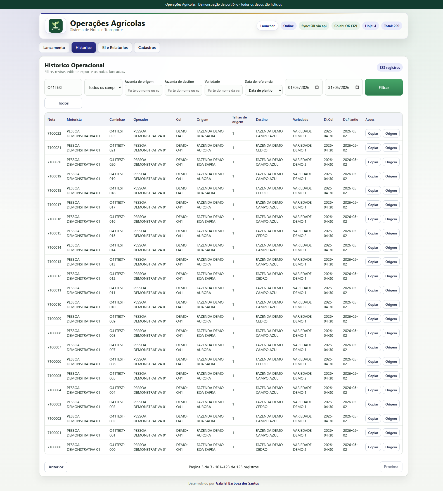
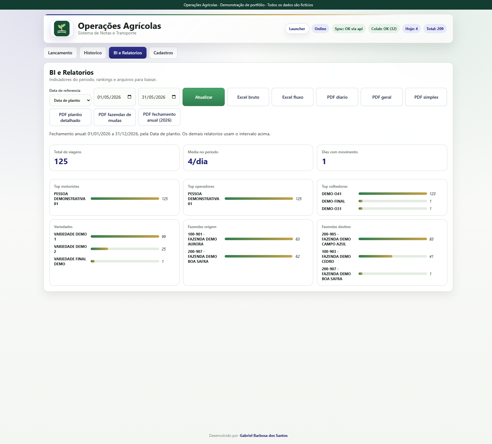

# Notas e Transporte — Transporte de Olhadura

Registro manual e consulta do transporte de mudas de cana para plantio. Uma nota representa uma viagem, com uma fazenda de origem, uma fazenda de destino e uma variedade. A demonstração integrada utiliza somente nomes, cadastros e registros fictícios.

O fluxo nasceu de uma rotina administrativa: receber a nota física preenchida no campo, digitar seus dados, consultar o histórico e gerar relatórios. A entrada continua manual. A migração de planilhas foi uma necessidade inicial; não é apresentada como importação recorrente de notas no portal.

## O que pode ser consultado

- Viagens entre fazendas e procedência das mudas recebidas por um destino.
- Variedades transportadas/plantadas e talhões de origem envolvidos.
- Períodos de colheita ou de plantio, históricos, totais e rankings.
- Dados completos e agregados para análise em PDF e Excel.

## Regras e significado dos campos

**`talhao` é exclusivamente o talhão de origem**, onde a muda foi colhida. A fazenda de destino é registrada, mas seu talhão não é coletado. Não há preenchimento deduzido de destino. Uma eventual coleta a partir de 2027 deverá usar campo independente e opcional, preservando registros antigos ([semântica](SEMANTICA_TALHOES.md)).

O número é transcrito da nota impressa. O tratamento existente de colisões numéricas é preservado, com cópia em identificador derivado quando solicitada. Motorista/operador, dia, fazendas ou variedade semelhantes não tornam duas viagens duplicadas. O histórico tem proteção padrão contra sobrescrita/exclusão pela API e auditoria de referências; isso não significa cobertura absoluta de qualquer alteração possível.

Os indicadores contam **viagens**. Não há pesagem das mudas nem conversão automática apresentada como tonelagem medida.

## Histórico e datas

Origem e destino aceitam parte do nome ou código; variedade aceita parte do nome. São filtros independentes, combinados entre si e com a busca geral/campo selecionado. Busca por nota preserva prefixo numérico. A página mostra até 50 notas, com Anterior/Próxima, intervalo exibido e total encontrado. O banco aplica filtros e LIMIT/OFFSET; alterar critério volta à primeira página.

O período usa **Data de colheita por padrão**, com opção explícita por **Data de plantio**. Uma nota colhida em 30/04 e plantada em 02/05 entra em abril por colheita e em maio por plantio. As duas datas reais permanecem nos detalhes. Notas antigas sem data de plantio não são preenchidas automaticamente.

Os filtros são preservados durante a sessão do navegador; a consulta reabre na primeira página. Armazenamento bloqueado desativa apenas essa preferência. Datas padrão usam o dia civil local. Respostas antigas de autocomplete não substituem resultados mais recentes nem talhões de outra origem.

[Detalhes de datas](FILTROS_DATAS.md) · [Consulta paginada e mapa de código](HISTORICO_PAGINADO.md)

## Relatórios disponíveis no navegador

| PDF | Conteúdo e recorte |
| --- | --- |
| Diário | Viagens agrupadas pela data de referência escolhida. |
| Geral | Origens, variedades, destinos e pendências do período. |
| Simples | Visão resumida dos fluxos entre fazendas. |
| Plantio detalhado | Nota, duas datas reais, fazendas de origem/destino, talhão de origem e variedade. |
| Histórico de fazendas de mudas | Fazendas com notas no recorte; primeiras/últimas datas consideram o histórico dessas fazendas. |
| Fechamento anual | **01/01 a 31/12 do ano da data final**, selecionando notas pela referência escolhida. O intervalo completo é informado antes do download. |

Excel bruto e Excel de fluxo usam todo o período do painel de relatórios; não se limitam à página do histórico nem aplicam automaticamente seus filtros textuais. A coluna técnica `talhao` do bruto mantém o nome anterior e significa origem. PDFs e planilhas identificam a data de referência.

[Lançamento sintético](../docs/screenshots/notas-lancamento.png) · [Filtros combinados](../docs/screenshots/notas-filtros.png)

## Executar, testar e estudar

Use o [controlador da demonstração](../README.md#executar-localmente), entrando por seu portal autenticado. Não aponte a demonstração para bancos operacionais.

`python demo.py test` executa as suítes Python, testes web em Node, testes específicos de Notas em PostgreSQL real e testes TypeScript existentes. `scripts/test_notas_postgres.py` permite repetir o grupo PostgreSQL, sempre em bancos temporários do cluster demonstrativo. [Registro de validação e limites](../docs/VALIDACAO.md).

Para estudar: `web_app/static/app.js` monta os filtros e atualiza a tela; `web_app/server.py` recebe as requisições; `database.py` constrói consultas; `date_reference.py` valida as duas opções; `reporting/` coleta dados e gera PDFs. `tests/test_history_pagination.py`, `tests/test_date_reference.py` e `tests/web_usability.test.cjs` exercitam esses contratos.

## Autoria e participação

Gabriel Barbosa concebeu o fluxo a partir das necessidades de sua rotina, definiu os campos e regras de negócio e orientou a validação funcional. Ferramentas de IA apoiaram implementação, testes e documentação. A demonstração comprova comportamentos e verificações de software; não publica resultados empresariais nem percentuais de produtividade.
